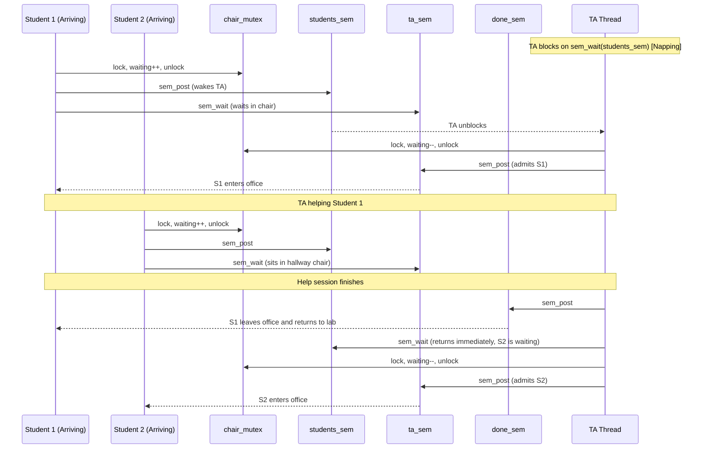

# The Sleeping Teaching Assistant

An operating systems concurrency simulation in C implementing the classic **Sleeping Teaching Assistant** synchronization problem using **POSIX threads (pthreads)**, **mutex locks**, and **semaphores**.

---

## 📋 Problem Statement

A university computer science department has a teaching assistant (TA) who helps undergraduate students with their programming assignments during regular office hours:
1. **Office Capacity**: The TA's office has room for only one desk with a chair and computer — **at most one student is helped at any time**.
2. **Hallway Chairs**: Outside the office, there are three chairs where students can sit and wait if the TA is busy.
3. **Napping TA**: When there are no students needing help, the TA sits at the desk and takes a nap.
4. **Waking the TA**: If a student arrives and finds the TA sleeping, the student awakens the TA.
5. **Waiting in Hallway**: If a student arrives while the TA is busy, the student sits in a hallway chair if one is available.
6. **Full Chairs**: If no hallway chairs are available, the student leaves and returns at a later time.

---

## ⚡ Quick Start (How to Run)

### 1. Compile the Project
In the root directory of the project, run:
```bash
make
```
This produces the executable `./ta`.

### 2. Execute the Simulation

#### Default Run (5 students, 3 chairs, 3 help sessions each):
```bash
./ta
```

#### Custom Parameter Run:
```bash
./ta -s <students> -c <chairs> -n <helps_per_student>
```

**Example Commands:**
```bash
# Demo run with 4 students, 3 hallway chairs, and 2 helps each:
./ta -s 4 -c 3 -n 2

# High-concurrency run with 10 students (triggers chair overflow and retry loop):
./ta -s 10 -c 3 -n 2

# Display help and usage options:
./ta -h
```

---

## 💻 Command-Line Flags

| Flag | Parameter | Default | Description |
|:---:|:---:|:---:|:---|
| `-s` | `<num>` | `5` | Total number of student threads to create |
| `-c` | `<num>` | `3` | Total number of hallway chairs available |
| `-n` | `<num>` | `3` | Number of times each student must be helped before completing |
| `-h` | — | — | Print usage help message |

---

## 🛠️ Build Targets & Verification

The included `Makefile` provides several build targets for debugging and concurrency verification:

```bash
# 1. Standard build
make

# 2. Build with ThreadSanitizer (detects data races)
make tsan
./ta_tsan -s 6 -c 3 -n 2

# 3. Build with AddressSanitizer & LeakSanitizer (verifies memory safety and zero leaks)
make asan
./ta_asan -s 6 -c 3 -n 2

# 4. Quick automated test
make test

# 5. Clean build artifacts
make clean
```

---

## 🔄 Synchronization Architecture

### Shared State & Primitives
- **`pthread_mutex_t chair_mutex`**: Protects access to the shared counter `waiting_students` and the `ta_sleeping` status flag. Mutex locks are held only for short critical sections and **never** while blocking on semaphores.
- **`sem_t students_sem` (init: 0)**: Counting semaphore representing students waiting in chairs. The TA thread blocks here to sleep when no students are present.
- **`sem_t ta_sem` (init: 0)**: Permission semaphore posted by the TA to admit one waiting student from the hallway into the office.
- **`sem_t done_sem` (init: 0)**: Coordination semaphore posted by the TA when the help session finishes, ensuring the student does not leave prematurely.

### Sequence Flow



---

## 📁 File Structure

```
OS Project/
├── Makefile                # Build scripts (all, tsan, asan, clean, test)
├── README.md               # Project documentation and guide
├── prd.md                  # Product Requirements Document
├── goal.md                 # Goals and success criteria
├── plan.md                 # Step-by-step milestone tracking
├── digram.md               # Mermaid diagrams and flowcharts
└── src/
    ├── main.c              # Entry point, CLI parsing, thread creation/joining, shutdown
    ├── shared.h            # Global variables and semaphore declarations
    ├── ta.h / ta.c         # TA thread function (napping, helping, termination)
    ├── student.h / student.c # Student thread function (programming, waiting, retry)
    └── util.h / util.c     # Thread-safe timestamped logger and sleep utilities
```

---

## 🖥️ Sample Execution Output

```text
$ ./ta -s 4 -c 3 -n 1

[  0.000s] =================================================
[  0.000s]        THE SLEEPING TEACHING ASSISTANT          
[  0.000s] =================================================
[  0.000s] Configuration:
[  0.000s]   - Total Students:         4
[  0.000s]   - Hallway Chairs:         3
[  0.000s]   - Helps Required/Student: 1
[  0.000s] =================================================
[  0.000s] [TA] Teaching Assistant arrived at office and opened office hours.
[  0.000s] [TA] No students waiting. TA sits at desk and takes a nap (Zzz...).
[  0.001s] [Student 1] Started programming assignments (needs help 1 times).
[  0.001s] [Student 2] Started programming assignments (needs help 1 times).
[  0.001s] [Student 3] Started programming assignments (needs help 1 times).
[  0.001s] [Student 4] Started programming assignments (needs help 1 times).
[  0.228s] [Student 3] Encountered a bug! Heading to TA's office for help.
[  0.228s] [Student 3] Found TA sleeping! Student awakens TA (hallway chairs occupied: 1/3).
[  0.228s] [TA] Calling next student into office (hallway chairs occupied: 0/3).
[  0.228s] [TA] Helping student with programming assignment (245 ms)...
[  0.228s] [Student 3] Entering office and getting help from TA.
[  0.249s] [Student 2] Encountered a bug! Heading to TA's office for help.
[  0.249s] [Student 2] TA is currently helping another student. Student sits on a chair in the hallway (chairs occupied: 1/3).
[  0.343s] [Student 1] Encountered a bug! Heading to TA's office for help.
[  0.343s] [Student 1] TA is currently helping another student. Student sits on a chair in the hallway (chairs occupied: 2/3).
[  0.473s] [TA] Finished helping student.
[  0.473s] [TA] Calling next student into office (hallway chairs occupied: 1/3).
[  0.473s] [Student 3] Finished receiving help from TA (0/1 helps remaining). Returning to lab.
[  0.473s] [Student 3] Finished all programming assignments! Exiting.
[  0.473s] [Student 2] Entering office and getting help from TA.
...
[  1.250s] [TA] No students waiting. TA sits at desk and takes a nap (Zzz...).
[  1.251s] =================================================
[  1.251s] All students have completed their assignments!
[  1.251s] Notifying TA to wrap up office hours...
[  1.251s] =================================================
[  1.251s] [TA] Office hours ended. TA leaving office. Goodbye!
[  1.251s] Simulation completed successfully. Clean shutdown.
```
