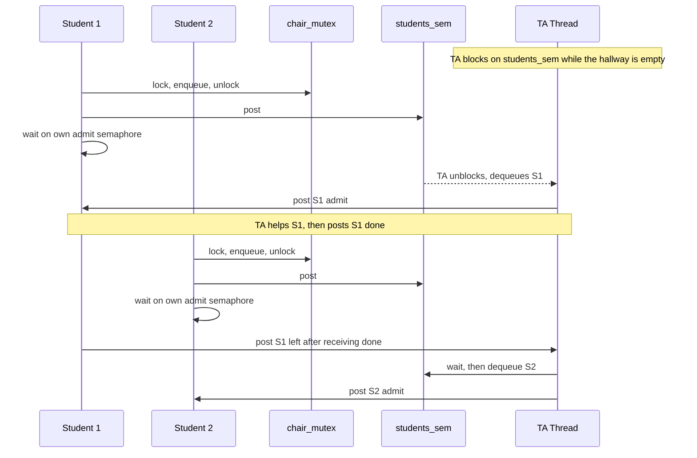

# The Sleeping Teaching Assistant

An operating systems concurrency simulation in C implementing the classic **Sleeping Teaching Assistant** synchronization problem using **POSIX threads (pthreads)**, **mutex locks**, and **semaphore**.

---

## 📋 Problem Statement

A university computer science department has a teaching assistant (TA) who helps undergraduate students with their programming assignments during regular office hours:
1. **Office Capacity**: The TA's office has room for only one desk with a chair and computer — **at most one student is helped at any time**.
2. **Hallway Chairs**: Outside the office, there are three chairs where students can sit and wait if the TA is busy.
3. **Napping TA**: When there are no students needing help, the TA sits at the desk and takes a nap.
4. **Waking the TA**: If a student arrives and finds the TA sleeping, the student awakens the TA.
5. **Waiting in Hallway**: If a student arrives while the TA is busy, the student sits in a hallway chair if one is available.
6. **Full Chairs**: If no hallway chairs are available, the student leaves and returns at a later time.

---

## ⚡ Quick Start (How to Run)

### 1. Compile the Project
In the root directory of the project, run:
```bash
make
```
This produces the executable `./ta`. The same command works on Linux and macOS. On macOS the semaphores are named, because unnamed `sem_init` is not implemented there.

### 2. Execute the Simulation

#### Default Run (5 students, 3 chairs, 3 help sessions each):
```bash
./ta
```

#### Custom Parameter Run:
```bash
./ta -s <students> -c <chairs> -n <helps_per_student>
```

**Example Commands:**
```bash
# Demo run with 4 students, 3 hallway chairs, and 2 helps each:
./ta -s 4 -c 3 -n 2

# High-concurrency run with 10 students (triggers chair overflow and retry loop):
./ta -s 10 -c 3 -n 2

# Display help and usage options:
./ta -h
```

---

## 💻 Command-Line Flags

| Flag | Parameter | Default | Description |
|:---:|:---:|:---:|:---|
| `-s` | `<num>` | `5` | Total number of student threads to create |
| `-c` | `<num>` | `3` | Total number of hallway chairs available |
| `-n` | `<num>` | `3` | Number of times each student must be helped before completing |
| `-p` | `<ms>` or `<min:max>` | `200:600` | Programming delay before each office visit. `0` makes students arrive together |
| `-t` | `<ms>` or `<min:max>` | `150:400` | How long the TA helps one student |
| `-r` | `<ms>` or `<min:max>` | `300:700` | Delay before a turned-away student retries |
| `-h` | — | — | Print usage help message |

---

## 🛠️ Build Targets and Verification

The included `Makefile` provides several build targets for debugging and concurrency verification:

```bash
# 1. Standard build
make

# 2. Build with ThreadSanitizer (detects data races)
make tsan
./ta_tsan -s 6 -c 3 -n 2

# 3. Build with AddressSanitizer & LeakSanitizer (verifies memory safety and zero leaks)
make asan
./ta_asan -s 6 -c 3 -n 2

# 4. Quick automated test
make test

# 5. Clean build artifacts
make clean
```

---

## 🔄 Synchronization Architecture

### Shared State & Primitives
- **`pthread_mutex_t chair_mutex`**: Protects `waiting_students`, the hallway queue, and `ta_sleeping`. It is never held while blocking on a semaphore, and never held across logging.
- **`students_sem` (init: 0)**: Counting semaphore. A student posts once for each chair taken. The TA blocks here when the hallway is empty, so a wakeup cannot be lost.
- **Per-student `admit`, `done`, and `left` semaphores**: The hallway is a FIFO queue. The TA admits the student at the head, helps that student, then waits until that same student has taken the completion signal and left. A later student cannot consume someone else's help.
- On macOS these are named semaphores (`sem_open`). Unnamed `sem_init` is not implemented there. On Linux they are unnamed.

### Sequence Flow



---

## 📁 File Structure

```
OS Project/
├── Makefile                # Build scripts (all, tsan, asan, clean, test)
├── README.md               # Project documentation and guide
├── prd.md                  # Product Requirements Document
├── goal.md                 # Goals and success criteria
├── plan.md                 # Step-by-step milestone tracking
├── digram.md               # Mermaid diagrams and flowcharts
└── src/
    ├── main.c              # Entry point, CLI parsing, thread creation/joining, shutdown
    ├── shared.h            # Global variables and semaphore declarations
    ├── ta.h / ta.c         # TA thread function (napping, helping, termination)
    ├── student.h / student.c # Student thread function (programming, waiting, retry)
    └── util.h / util.c     # Thread-safe timestamped logger and sleep utilities
```

---

## 🖥️ Sample Execution Output

```text
$ ./ta -s 1 -c 3 -n 1 -p 50 -t 20

[  0.000s] [tid 0x1f5dde180] =================================================
[  0.000s] [tid 0x1f5dde180]        THE SLEEPING TEACHING ASSISTANT
[  0.000s] [tid 0x1f5dde180] =================================================
[  0.000s] [tid 0x1f5dde180] Configuration:
[  0.000s] [tid 0x1f5dde180]   - Total Students:         1
[  0.000s] [tid 0x1f5dde180]   - Hallway Chairs:         3
[  0.000s] [tid 0x1f5dde180]   - Helps Required/Student: 1
[  0.000s] [tid 0x1f5dde180]   - Programming delay:      50-50 ms
[  0.000s] [tid 0x1f5dde180]   - Help duration:          20-20 ms
[  0.000s] [tid 0x1f5dde180] =================================================
[  0.000s] [tid 0x16bd8f000] [TA] Teaching Assistant arrived at office and opened office hours.
[  0.000s] [tid 0x16bd8f000] [TA] No students waiting. TA is sleeping (Zzz...).
[  0.000s] [tid 0x16be1b000] [Student 1] Started programming assignments (needs help 1 times).
[  0.093s] [tid 0x16be1b000] [Student 1] Found TA sleeping! Student awakens TA (hallway chairs occupied: 1/3).
[  0.093s] [tid 0x16bd8f000] [TA] Calling student 1 into office (hallway chairs occupied: 0/3).
[  0.093s] [tid 0x16bd8f000] [TA] Helping student 1 with programming assignment (20 ms)...
[  0.093s] [tid 0x16be1b000] [Student 1] Entering office and getting help from TA.
[  0.165s] [tid 0x16bd8f000] [TA] Finished helping student 1.
[  0.165s] [tid 0x16be1b000] [Student 1] Finished receiving help from TA (0/1 helps remaining). Returning to lab.
[  0.165s] [tid 0x16be1b000] [Student 1] Finished all programming assignments! Exiting.
[  0.165s] [tid 0x16bd8f000] [TA] Office hours ended. TA leaving office. Goodbye!
[  0.165s] [tid 0x1f5dde180] Simulation completed successfully. Clean shutdown.
```
