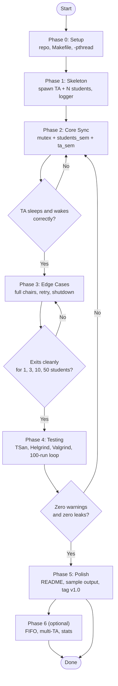
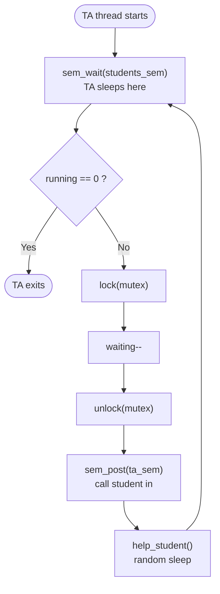
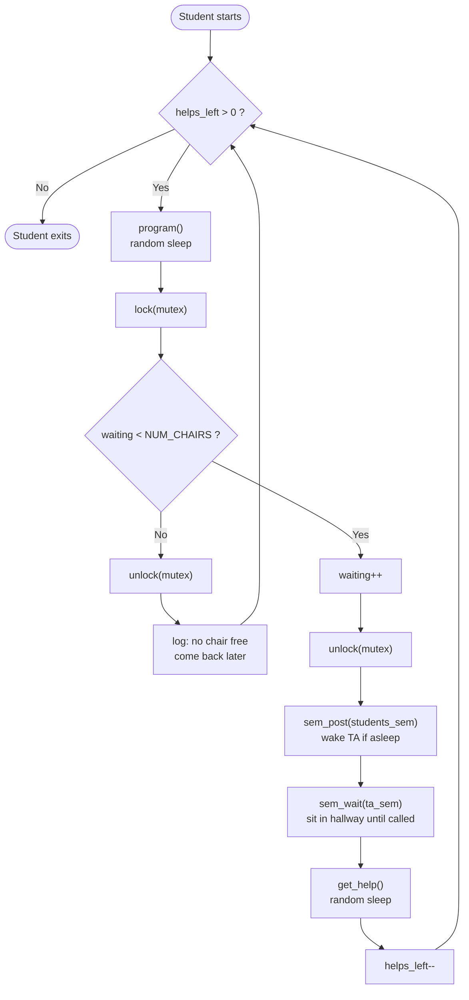
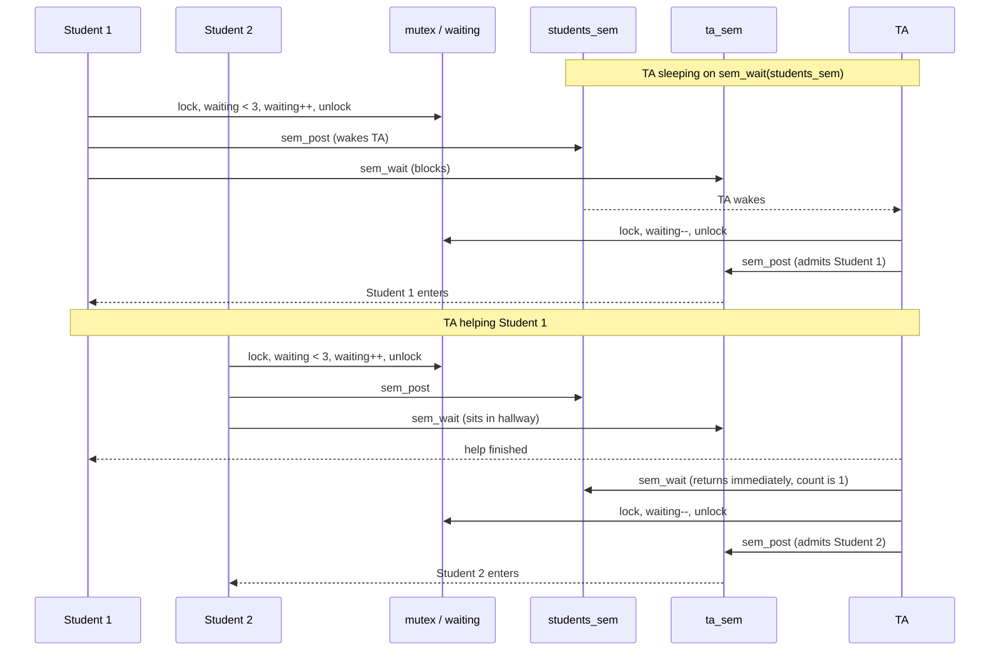
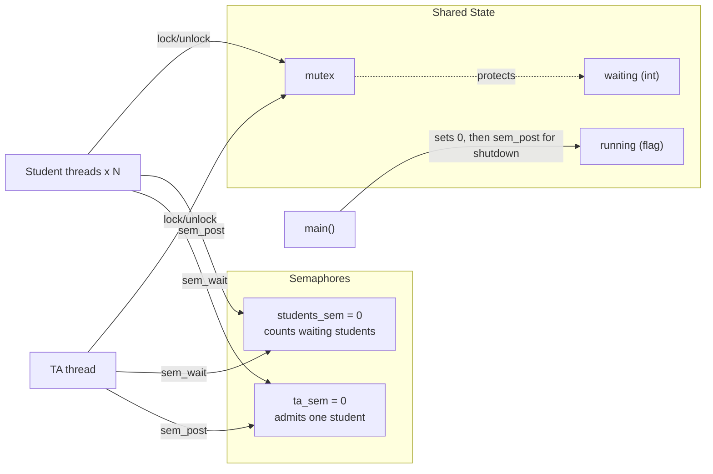

# Diagrams — The Sleeping Teaching Assistant

Four Mermaid diagrams: build roadmap, TA flow, student flow, and a runtime sequence.

---

## 1. Project Build Roadmap

---

## 2. TA Thread Flow

---

## 3. Student Thread Flow

---

## 4. Runtime Sequence (TA asleep, then busy)

---

## 5. Synchronization Primitives Map

